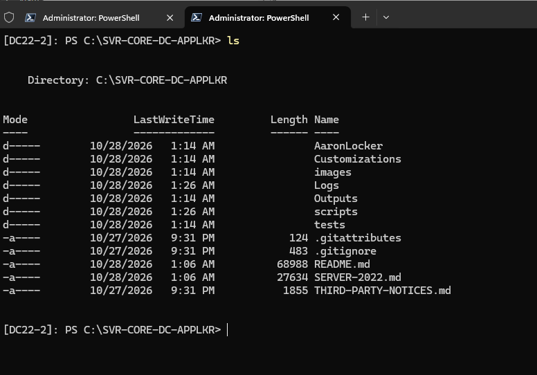
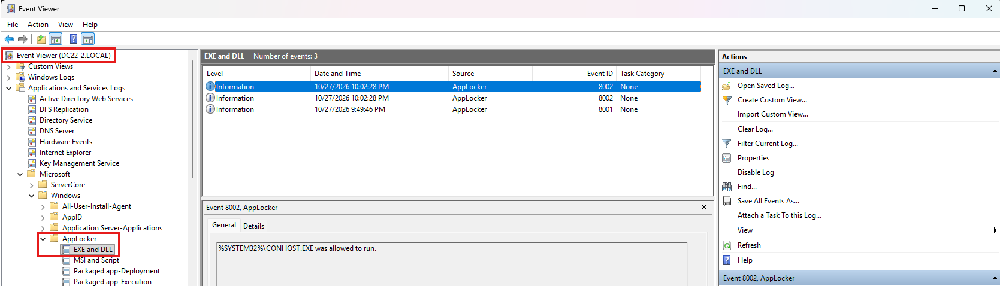
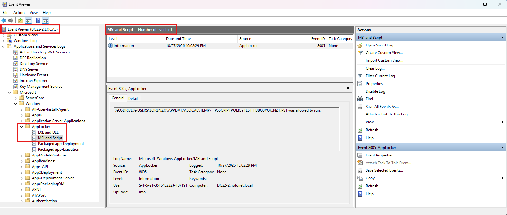

# AppLocker on Server Core 2022 domain controllers

Part of [SVR-CORE-DC-APPLKR](README.md). The README and the lab run use **Windows Server 2025**. This page is for domain controllers that run **Windows Server 2022 (Server Core)**, alone or next to 2025 DCs.

> [!NOTE]
> **The steps in the README are the same on Server 2022:** same AppLocker, same policy format, same two GPOs, same scripts. Three things differ, and the scripts handle each one:
> 1. **The reference DC.** The policy is built from what the build finds on a DC's disk, so the build must scan every Windows Server version it protects. With DCs of both versions, list one DC of the other version in `ExtraReferenceServers`: the build scans it too and merges the scans. Pre-flight warns when a DC runs a version that no reference DC runs ([section 2](#2-cover-every-windows-server-version-in-the-build)).
> 2. **PowerShell 2.0.** It can still be installed on Server 2022, and it doesn't apply the Constrained Language Mode that AppLocker's script rules rely on. Pre-flight warns when it's installed. Remove it ([section 3](#3-remove-powershell-20-from-the-2022-dcs)).
> 3. **The STIG IDs.** The Server 2022 item is **WN22-00-000080 / V-254245**. `6_AL_stig_check.ps1` reports each DC under the item for its version ([section 4](#4-the-server-2022-stig-ids)). Setting Audit, then Enforce, the STIG result after each, and the rollback to Audit: [section 4](#audit-then-enforce-the-stig-result-after-each-mode).
>
> **Where to run it:** from a PAW joined to the DCs' domain, with nothing copied to the DCs (the default), or on a DC itself with the repository copied there from the PAW: [Before you start](#before-you-start-where-to-run-the-toolkit).
>
> And one thing to watch for: a Server Core 2022 DC that receives the GPO but logs **AppLocker event 8000** (*AppID policy conversion failed*) instead of 8001 has **no policy loaded**. [Section 7](#7-applocker-event-8000-on-a-server-core-2022-dc-the-policy-is-delivered-but-not-applied) says how to diagnose it (`7_AL_diagnose.ps1`) and what to test first (`EnableAppxRules = $false`).

## Contents

- [Before you start: where to run the toolkit](#before-you-start-where-to-run-the-toolkit) - from a PAW, or copied to the DC (optional)

1. [Which case are you in?](#1-which-case-are-you-in)
2. [Cover every Windows Server version in the build](#2-cover-every-windows-server-version-in-the-build)
3. [Remove PowerShell 2.0 from the 2022 DCs](#3-remove-powershell-20-from-the-2022-dcs)
4. [The Server 2022 STIG IDs](#4-the-server-2022-stig-ids)
   - [Audit, then Enforce: the STIG result after each mode](#audit-then-enforce-the-stig-result-after-each-mode) - and how to roll back to Audit
5. [What stays the same](#5-what-stays-the-same)
6. [AppLocker on Server Core: Microsoft's support statement](#6-applocker-on-server-core-microsofts-support-statement)
7. [AppLocker event 8000 on a Server Core 2022 DC: the policy is delivered but not applied](#7-applocker-event-8000-on-a-server-core-2022-dc-the-policy-is-delivered-but-not-applied)
8. [Checklist](#8-checklist)
- [Sources](#sources)

---

## Before you start: where to run the toolkit

**From a PAW (the default).** Run every script on a PAW or another management computer that is joined to the DCs' domain and has RSAT, as the README describes ([sections 3 and 4](README.md#3-prerequisites)). Nothing is copied to the DCs by hand: the build copies AaronLocker to `C:\AaronLocker` on the reference DC over WinRM and deletes it afterwards, and every other step works over WinRM and Group Policy. The lab's Server Core 2025 DC was done this way.

**On the DC itself (optional).** Copy the repository to a DC and run the scripts there when:

- no management computer is joined to the DCs' domain. The lab's Server Core 2022 DC is the only DC of its own forest, and the PAW belongs to another forest;
- the PAW cannot reach the DCs over WinRM; or
- you want the toolkit and its evidence (`Logs`, `Outputs`) on the DC.

Every DC already has the Group Policy and Active Directory modules, so nothing has to be installed. When a script targets the computer it runs on, it does the work in-process instead of over WinRM, so the build also works when the DC is its own reference server.

### Copy the repository from the PAW to the DC

You need the repository zip on the PAW, as in [README section 4](README.md#4-bring-the-repository-into-the-disconnected-network) (*Code > Download ZIP*, carried across your transfer path), and WinRM from the PAW to the DC, which Windows Server enables by default. No file share is used. In PowerShell on the PAW, in the folder that holds the zip, set the three values, then run the block:

```powershell
$Dc   = 'dc22-01.contoso.com'               # the DC that runs the toolkit
$Zip  = '.\SVR-CORE-DC-APPLKR-main.zip'     # the repository zip
$Dest = 'C:\SVR-CORE-DC-APPLKR'             # on the DC; never under C:\AaronLocker (the build deletes that folder)

Unblock-File -LiteralPath $Zip                                      # clear the "downloaded from the Internet" mark on the PAW
$Hash = (Get-FileHash -LiteralPath $Zip -Algorithm SHA256).Hash     # compare with your transfer record
$S = New-PSSession -ComputerName $Dc

# 1. An administrators-only folder on the DC (a new folder under C:\ would let every user create files in it)
Invoke-Command -Session $S -ArgumentList $Dest -ScriptBlock {
    param($Dest)
    New-Item -Path $Dest -ItemType Directory -Force | Out-Null
    icacls.exe $Dest /inheritance:r /grant:r '*S-1-5-18:(OI)(CI)F' '*S-1-5-32-544:(OI)(CI)F' | Out-Null
}

# 2. Copy the zip over WinRM (no file share needed), check its hash on the DC, unpack it, unblock every file
Copy-Item -LiteralPath $Zip -Destination "$Dest\repo.zip" -ToSession $S
Invoke-Command -Session $S -ArgumentList $Dest, $Hash -ScriptBlock {
    param($Dest, $Hash)
    $File = Join-Path $Dest 'repo.zip'
    if ((Get-FileHash -LiteralPath $File -Algorithm SHA256).Hash -ne $Hash) { throw 'The zip on the DC does not match the zip on the PAW.' }
    $Tmp = Join-Path $Dest '_unpack'
    Expand-Archive -LiteralPath $File -DestinationPath $Tmp -Force
    # A GitHub zip holds one top folder (SVR-CORE-DC-APPLKR-main); its content goes into $Dest. Logs and Outputs of earlier runs stay.
    $Top = Get-ChildItem -LiteralPath $Tmp -Directory | Select-Object -First 1
    Copy-Item -Path (Join-Path $Top.FullName '*') -Destination $Dest -Recurse -Force
    Remove-Item -LiteralPath $Tmp, $File -Recurse -Force
    Get-ChildItem -LiteralPath $Dest -Recurse -File | Unblock-File   # clear the "downloaded from the Internet" mark on the DC
    Get-ChildItem -LiteralPath $Dest | Select-Object Mode, LastWriteTime, Name
}
Remove-PSSession $S
```

1. It creates the folder on the DC for SYSTEM and Administrators only. A new folder under `C:\` would otherwise let every user create files in it, next to scripts that a Domain Admin runs.
2. It copies the zip over WinRM and refuses it if its SHA-256 on the DC differs from the one on the PAW. It then unpacks the zip into the folder and deletes it.
3. It runs `Unblock-File` twice: on the zip on the PAW before the copy, and on every file on the DC after unpacking. A zip downloaded from the Internet carries the *downloaded from the Internet* mark; files that keep it count as remote under the execution policy (`RemoteSigned`), and the toolkit's scripts are not signed.
4. The listing at the end must show `AaronLocker`, `Customizations`, `images`, `scripts`, `tests` and the `.md` files.

To update the copy later, run the same block with the newer zip. The files are replaced; the `Logs` and `Outputs` of earlier runs stay.

Copied the repository to the DC another way (an SMB share, removable media, unpacked with Explorer)? Those copies keep the mark. Unblock every file once on the DC, at its console or in a remote session:

```powershell
Get-ChildItem -LiteralPath C:\SVR-CORE-DC-APPLKR -Recurse -File | Unblock-File
```

**Your settings.** Edit `AL-Settings.psd1` on the PAW (`ReferenceServer` = a DC in scope, for example this one) and copy it over the DC's copy:

```powershell
$S = New-PSSession -ComputerName $Dc
Copy-Item -LiteralPath '.\AL-Settings.psd1' -Destination "$Dest\scripts\" -ToSession $S     # your edited settings file
Remove-PSSession $S
```

### Run the scripts on the DC

At the DC's console (on Server Core, exit `sconfig` to PowerShell), or from the PAW in a remote session (`Enter-PSSession -ComputerName $Dc`). The README's run order applies unchanged ([section 6](README.md#6-run-order-at-a-glance)):

```powershell
Set-Location C:\SVR-CORE-DC-APPLKR\scripts
powershell.exe -NoProfile -ExecutionPolicy Bypass -File .\0_AL_get_toolkit.ps1
powershell.exe -NoProfile -ExecutionPolicy Bypass -File .\0_AL_pre-flight.ps1
# ... and so on: 0_AL_secure_folders, 1_AL_build_policy, 2_AL_create_gpos, 3_AL_set_mode -Mode Audit -Refresh, 4_AL_validate
```

Setting Audit and then Enforce, with the STIG result after each mode and the rollback to Audit: [section 4](#audit-then-enforce-the-stig-result-after-each-mode).

| Where you run them | What to know |
|---|---|
| At the DC's console | The Y/N prompts work as on a management computer. With more than one DC in scope, run the scripts here: your console logon lets the DC reach the other DCs over WinRM. |
| In a remote session from the PAW | The scripts cannot show a Y/N prompt there, so each script that changes something stops with *STOP: this change needs a Y/N confirmation but the session is non-interactive*. Check the plan with `-WhatIf`, then run the script again with `-NoConfirm`. A remote session also cannot open a second WinRM hop: with more than one DC in scope, the DC cannot reach the other DCs from there. Use the console, or the PAW. |



<sub>The repository on the lab's DC22-2, in a remote PowerShell session. The runs created `Logs` and `Outputs` there.</sub>

### Bring the results back to the PAW

The transcripts, CSV results, rule files, gpresult reports and evidence files are written to `Logs` and `Outputs` on the DC. Copy them to the PAW for your records:

```powershell
New-Item -Path '.\DC-run' -ItemType Directory -Force | Out-Null
$S = New-PSSession -ComputerName $Dc
Copy-Item -Path "$Dest\Logs", "$Dest\Outputs" -Destination '.\DC-run' -FromSession $S -Recurse -Force
Remove-PSSession $S
```

> [!NOTE]
> **Lab status (2026-10-27).** Verified from the lab's Windows 11 management computer against DC22-2, with a zip in GitHub's layout: a fresh copy (73 of 73 files, the folder for SYSTEM and Administrators only, no leftovers), an update over a copy that already had `Logs` (kept), the *downloaded from the Internet* mark removed from the zip on the PAW and from every file on the DC (also with the standalone command, on files marked on purpose), `0_AL_get_toolkit.ps1` run from the copy, and `Logs` and `Outputs` copied back. A remote session reported itself non-interactive, so the scripts' Y/N prompts need `-NoConfirm` there. The full run on that DC, up to Audit, is in [section 7](#7-applocker-event-8000-on-a-server-core-2022-dc-the-policy-is-delivered-but-not-applied).

---

## 1. Which case are you in?

List your DCs and their versions (on the management computer, with the RSAT Active Directory module):

```powershell
Get-ADDomainController -Filter * | Sort-Object HostName |
    Format-Table HostName, OperatingSystem, OperatingSystemVersion -AutoSize
```

Build **20348** is Windows Server 2022; build **26100** is Windows Server 2025. `0_AL_pre-flight.ps1` shows each DC's version in its `Server` rows and compares it with the reference DCs in its `Version` rows.

| Your DCs | What to do |
|---|---|
| **All Server 2025** | Nothing on this page applies. Follow the [README](README.md). |
| **All Server 2022** | Follow the README with a **2022 DC as `ReferenceServer`** ([section 2](#all-your-dcs-run-server-2022)), and remove PowerShell 2.0 ([section 3](#3-remove-powershell-20-from-the-2022-dcs)). |
| **A mix of 2022 and 2025** | Also list one DC of the other version in **`ExtraReferenceServers`** ([section 2](#dcs-of-both-versions)), and remove PowerShell 2.0 from the 2022 DCs. |

---

## 2. Cover every Windows Server version in the build

### Why it matters

For accounts that aren't administrators, the policy allows everything under `C:\Windows` and `C:\Program Files*` **except the folders such an account can write to**. Otherwise anyone could copy a program into one of those folders and run it. AaronLocker finds those folders by scanning a DC's disk, and each build keeps the list in `Outputs\<profile>\<timestamp>\ScanResults\Writable_*.txt`.

A 2022 DC can have user-writable folders that a 2025 DC doesn't have, and the other way round. **A folder that is missing from the list stays allowed** on every DC that has it: a non-admin could copy a program there and run it, even in Enforce. Nothing breaks, so the **Audit period won't show this gap**.

The deny list works the same way. The policy denies the bypass tools (`cipher`, `runas`, `WMIC`, `MSBuild`, ...) by publisher, product and file name, at any version, but only the tools the scan found. The lab's Server Core 2025 DC has no `mshta.exe` and no `IEExec.exe` (part of .NET Framework 3.5), so a build made on it alone has no rule for either.

### All your DCs run Server 2022

Set `ReferenceServer` in `scripts\AL-Settings.psd1` to one of your 2022 DCs (the PDC emulator is a good choice) and follow the README as written. Pre-flight must show `Versions: every server checked runs the version of a reference server`. The lab verification ([README, Appendix A](README.md#appendix-a--lab-verification-2026-10-26)) ran on Server 2025, so on Server 2022 your Audit period is the proof. Don't shorten it.

### DCs of both versions

All DCs sit in the Domain Controllers OU and get the same GPO, so one policy has to fit both versions. Keep your usual `ReferenceServer` and add **one DC of the other version** to `ExtraReferenceServers` in `scripts\AL-Settings.psd1`:

```powershell
    ReferenceServer   = 'dc25-01.contoso.com'                # a Server 2025 DC: the rules are generated here
    ExtraReferenceServers = @('dc22-01.contoso.com')         # a Server 2022 DC: scanned too
```

**Step 1 — Check.** Run `.\0_AL_pre-flight.ps1`. It checks the extra reference DC the same way as the reference DC (WinRM, `FullLanguage`, an execution policy that runs unsigned scripts), then compares every DC's version with both:

| Pre-flight shows | Means | Do |
|---|---|---|
| `Versions` (OK): *every server checked runs the version of a reference server* | The build scans every version in scope | Build |
| `Version <DC>` (WARN) | That DC runs a Windows version, or an installation type (Server Core or Desktop Experience), that no reference DC runs | Add a DC like it to `ExtraReferenceServers` |
| `PowerShell 2.0 <DC>` (WARN) | The `PowerShell-V2` feature is installed on that DC | [Section 3](#3-remove-powershell-20-from-the-2022-dcs) |

To try a DC before you edit the settings: `.\0_AL_pre-flight.ps1 -ExtraReferenceServers dc22-01.contoso.com`.

**Step 2 — Build.** Run `.\1_AL_build_policy.ps1`, or add `-ExtraReferenceServers dc22-01.contoso.com` for a single run. On top of the README's [step 4](README.md#step-4--build-the-baseline), it:

1. Prepares a temporary folder on each extra reference DC too (`C:\AaronLocker-1`, `C:\AaronLocker-2`, ..., deleted afterwards). A DC that can't run AaronLocker stops the build before the first scan.
2. Scans the reference DC and each extra reference DC.
3. Merges the scans: every user-writable folder and every denied tool that **any** of them found. A merge only adds exceptions and deny rules, so the policy can only get stricter.
4. Generates the rules again on the reference DC from the merged scan, and checks that the rules carry every merged entry. If one is missing, it stops: nothing is deployed and `latest.txt` doesn't change.

The output says what the other version added, for example:

```text
Extra reference server: DC22-01 | Microsoft Windows Server 2022 Datacenter Server Core (build 20348) | ...
The extra reference servers add 2 entries to the scan of dc25-01.contoso.com (excluded folders and denied tools that the rules now carry):
  dc22-01.contoso.com | Writable_windir.txt | <a folder that only this DC makes user-writable>
  dc22-01.contoso.com | ExeDenyListData.txt | <a tool that only this DC has>
Merged scan: all 17 excluded folder(s) and 10 denied tool(s) are in the rules.
```

If the other version adds nothing, it says *the extra reference servers add nothing to the scan of …: its scan covers them*, and the rules are the same as a build without them.

| In `Outputs\<profile>\<timestamp>\` | What it is |
|---|---|
| `ScanResults\` | The merged scan the rules were built from |
| `ScanResults-<DC>\` | Each DC's own scan |
| `build-info.json` | `ExtraReferenceServers` (each DC with its version), `MergedScan.AddedByExtraServers`, and `VersionsNotScanned` |

If a DC in the target OUs runs a version that none of the scanned DCs runs, the build ends with a warning that names it (the versions come from AD). Then deploy as usual: README steps 5 and 6. If you're already in Enforce, follow *Rebuild* in [README section 12](README.md#12-ongoing-operations).

**Step 3 — Read what the other version adds.** Each added line is a folder that a non-admin can write to on that DC, or a tool that only that DC has. In `ScanResults-<DC>\Writable_Full_windir.xml` (also `_PF` and `_PF86`), every excluded folder lists the accounts that can write to it (`Grantee`). The cause is often software rather than the Windows version:

- **An agent on only some DCs** (Defender for Endpoint, the MECM client, the Nessus Agent). The merged policy already excepts the folder on every DC. To keep the DCs alike, install the same agents everywhere. A `Package\S-1-15-2-...` grantee is an app container, not a user account. In the lab, those are Defender for Endpoint folders.
- **A group that really is an administrators group.** List it in `KnownAdmins` ([README, section 11](README.md#11-who-counts-as-an-administrator)) and build again.

> [!NOTE]
> **Lab status (2026-10-27):** the lab has one Server 2025 DC and no Server 2022 DC. The merge was verified there end to end with the same DC listed again under its short name, plus a simulated second scan with one extra folder and one extra tool: both ended up in the rules, and the self-check caught a policy that lacked them. A real mix of 2022 and 2025 DCs was not available, so your first merged build and its Audit period are the proof.

The same DC listed twice (for example by its short name and by its FQDN) only costs an extra scan. The build warns that it's the same computer.

<details>
<summary>For reference: the 16 folders the lab's Server 2025 build excludes under <code>C:\Windows</code> (2026-10-26)</summary>

```text
C:\Windows\Registration\CRMLog\*
C:\Windows\System32\Com\dmp\*
C:\Windows\System32\config\systemprofile\AppData\Local\Packages\lpacsenseimdscollector\AC\*
C:\Windows\System32\config\systemprofile\AppData\Local\Packages\lpacsensendr\AC\*
C:\Windows\System32\drivers\DriverData\*
C:\Windows\System32\drivers\DriverData:*
C:\Windows\System32\Microsoft\Crypto\RSA\MachineKeys\*
C:\Windows\System32\Tasks\*
C:\Windows\SYSVOL\domain\Policies\*
C:\Windows\SYSVOL\domain\Policies:*
C:\Windows\SysWOW64\Com\dmp\*
C:\Windows\SysWOW64\Tasks\*
C:\Windows\Tasks\*
C:\Windows\Temp\*
C:\Windows\tracing\*
C:\Windows\tracing:*
```

The two `lpacsense...` folders belong to Defender for Endpoint. The entries ending in `:*` cover alternate data streams on a writable folder. `Writable_PF.txt` and `Writable_PF86.txt` were empty.

</details>

---

## 3. Remove PowerShell 2.0 from the 2022 DCs

**Why:**

- For PowerShell, AppLocker's script rules are enforced by PowerShell itself. Windows PowerShell 5.1 runs a script the policy doesn't allow in **Constrained Language Mode**, and for a non-admin it runs the interactive session that way too.
- The **PowerShell 2.0 engine** is older than that behaviour, which arrived with PowerShell 5.0. A session started with `powershell.exe -Version 2` runs in full language mode, so the restriction the script rules rely on is gone.
- AaronLocker ships rules that block the 2.0 engine, but they are **DLL rules**, and this baseline turns DLL rules off (`EnableDllRules = $false`). The deployed policy doesn't block it.
- Server 2025 no longer includes PowerShell 2.0 (since the September 2025 update, KB5065426). **Server 2022 can still have it**, and DISA requires its removal anyway: **WN22-00-000410 / V-254278 (CAT II)**.

The 2.0 engine only runs where .NET Framework 3.5 is installed. Remove it either way: the STIG check looks at the `PowerShell-V2` feature, not at .NET.

**Check.** `0_AL_pre-flight.ps1` reports it for every DC:

| Pre-flight shows | Means |
|---|---|
| `PowerShell 2.0 <DC>` (WARN): *installed* | A finding (WN22-00-000410). Remove it (below). |
| `PowerShell 2.0 <DC>` (OK): *not installed (PowerShell-V2 Available)* or *Removed* | Not a finding. Nothing to do. |
| No `PowerShell 2.0` row for that DC | The feature doesn't exist there. Server 2025 DCs show this. |

To check by hand instead (on the management computer):

```powershell
$Dc2022 = @(Get-ADDomainController -Filter * | Where-Object OperatingSystem -like '*2022*' | ForEach-Object HostName)
if (-not $Dc2022) { 'No Server 2022 DCs found - nothing to do in this section.' }
else {
    Invoke-Command -ComputerName $Dc2022 -ScriptBlock { Get-WindowsFeature -Name PowerShell-V2, NET-Framework-Core } |
        Sort-Object PSComputerName, Name | Format-Table PSComputerName, Name, InstallState -AutoSize
}
```

**Remove** it from one DC first, then from the rest. `-WhatIf` shows what would happen and changes nothing:

```powershell
Invoke-Command -ComputerName dc22-01.contoso.com -ScriptBlock { Uninstall-WindowsFeature -Name PowerShell-V2 -WhatIf }
Invoke-Command -ComputerName dc22-01.contoso.com -ScriptBlock { Uninstall-WindowsFeature -Name PowerShell-V2 } |
    Format-Table PSComputerName, Success, RestartNeeded, ExitCode -AutoSize
```

- Removing a feature needs no installation media.
- If `RestartNeeded` says `Yes`, restart that DC in your maintenance window, one DC at a time.
- Run pre-flight again. The DC must now show `PowerShell 2.0` OK.
- Windows PowerShell 5.1 (`powershell.exe`), WinRM and this toolkit keep working. Only a script or tool that starts `powershell.exe -Version 2` stops working.

---

## 4. The Server 2022 STIG IDs

| Requirement | Server 2025 | Server 2022 |
|---|---|---|
| Deny-all, permit-by-exception (what this toolkit does) | **WN25-00-000080 / V-277992** (CAT II) | **WN22-00-000080 / V-254245** (CAT II) |
| PowerShell 2.0 not installed ([section 3](#3-remove-powershell-20-from-the-2022-dcs)) | — (PowerShell 2.0 is no longer part of the OS) | **WN22-00-000410 / V-254278** (CAT II) |

- **WN22-00-000080:** *Windows Server 2022 must employ a deny-all, permit-by-exception policy to allow the execution of authorized software programs.*
- **WN22-00-000410:** *Windows Server 2022 must not have Windows PowerShell 2.0 installed.*

`6_AL_stig_check.ps1` picks the item from each DC's Windows build, read from AD when the DC can't be reached. It reports a 2022 DC under **WN22-00-000080 / V-254245** and a 2025 DC under **WN25-00-000080 / V-277992**, with one summary line per item. The check is the same on both versions: `Get-AppLockerPolicy -Effective -XML`, and an enforced, deny-by-default policy. A DC of any other Windows version gets `Not_Reviewed`, with the AppLocker result in the `Reason` column, so you can record it under that version's own STIG item.

`6_AL_stig_check.ps1` doesn't check WN22-00-000410. Record that one from pre-flight's `PowerShell 2.0` rows or from the check in [section 3](#3-remove-powershell-20-from-the-2022-dcs).

Rule IDs (`SV-...`) change when DISA revises a rule, so match on the V-ID.

### Audit, then Enforce: the STIG result after each mode

README steps 6 to 9 on a Server 2022 DC, with what `6_AL_stig_check.ps1` reports after each mode. Run the commands in the PAW's `scripts` folder, or on the DC in `C:\SVR-CORE-DC-APPLKR\scripts` ([Before you start](#before-you-start-where-to-run-the-toolkit)). In a remote session (`Enter-PSSession`), add `-NoConfirm` to `3_AL_set_mode.ps1`: such a session cannot answer the Y/N prompt, so the script stops with *STOP: ... the session is non-interactive. Nothing was changed.*

**1. Audit.** Enable the Audit link, refresh the DC, validate, check the STIG item:

```powershell
.\3_AL_set_mode.ps1 -Mode Audit -Refresh      # Audit link enabled, Enforce link disabled, gpupdate twice, gpresult judged
.\4_AL_validate.ps1 -Mode Audit               # must end with: Validation: PASSED
.\6_AL_stig_check.ps1
```

In Audit the STIG item is **Open**. The rules log what they would block and block nothing, so this is the expected result: Audit is a staging step, not compliance.


<sub>The lab's DC22-2 in Audit (2026-10-28): **WN22-00-000080 / V-254245: Open**.</sub>

**2. The Audit period.** Leave Audit on and review what would have been blocked ([README, step 7](README.md#step-7--the-audit-period-and-review)):

```powershell
.\5_AL_review_events.ps1 -Days 14
```

Switch to Enforce only when the review shows nothing that the DC still needs. In the lab, DC22-2 had no would-be-blocked event (8003, 8006, 8021).

**3. Enforce.** Enable the Enforce link, refresh the DC, validate, check the STIG item:

```powershell
.\3_AL_set_mode.ps1 -Mode Enforce -Refresh    # Enforce link enabled, Audit link disabled, gpupdate twice, gpresult judged
.\4_AL_validate.ps1 -Mode Enforce             # must end with: Validation: PASSED
.\6_AL_stig_check.ps1
```

In Enforce the STIG item is **NotAFinding**: the EXE rules are enforced, with allow rules, and Application Identity is running.


<sub>The lab's DC22-2 in Enforce (2026-10-28): **WN22-00-000080 / V-254245: NotAFinding**.</sub>

Then check that the DC works (`dcdiag`, SYSVOL and NETLOGON, logons, Group Policy) and watch for blocked events (8004, 8007) with `5_AL_review_events.ps1` for a few days, including a reboot and a patch cycle.

> [!CAUTION]
> **Roll back to Audit as soon as Enforce blocks something the DC needs.** Run the rollback in the PAW's `scripts` folder, or on the DC in `C:\SVR-CORE-DC-APPLKR\scripts`, in an **elevated** session:
>
> ```powershell
> .\3_AL_set_mode.ps1 -Mode Audit -Refresh                # at a console: answer Y
> .\3_AL_set_mode.ps1 -Mode Audit -Refresh -NoConfirm     # in a remote session (Enter-PSSession) or for automation
> .\4_AL_validate.ps1 -Mode Audit                         # confirm: Audit link enabled, effective policy AuditOnly
> ```
>
> - The script disables the Enforce link first, then enables the Audit link, and runs `gpupdate` twice. Once the DC has refreshed, nothing is blocked any more; what Enforce would block is logged as 8003 / 8006 instead. `-WhatIf` shows the two link changes without making them.
> - Elevated administrators are always allowed, so Enforce cannot block the rollback itself. A **non-elevated** session cannot run the toolkit from `C:\SVR-CORE-DC-APPLKR`: in Enforce that folder is not an allowed path for non-admins. At the DC's console, `whoami /groups` must show *High Mandatory Level*. A remote session from the PAW is always elevated.
> - The STIG item is **Open** again until you return to Enforce. To remove the AppLocker rules entirely, use `-Mode Off` ([README, section 13](README.md#13-rollback)).

---

## 5. What stays the same

| Area | Server 2022 and Server 2025 |
|---|---|
| AppLocker | Same feature, rule collections and policy XML. A policy from either version loads on the other; what differs is what the scan found. |
| Deployment | The same two GPOs with one link enabled, and Application Identity set to Automatic through the GPO. |
| Remoting | WinRM is on by default on both, so the scripts reach the DCs the same way. |
| PowerShell on the DCs | Windows PowerShell 5.1 on both. |
| Logs and events | The same AppLocker logs and event IDs ([README, Appendix C](README.md#appendix-c--event-ids)). |
| Server Core deny-list fix | The `Customizations` overlay works on both. |
| The process | Audit before Enforce, the review, rollback and ongoing operations ([README, sections 7, 12 and 13](README.md#7-step-by-step)). |

---

## 6. AppLocker on Server Core: Microsoft's support statement

> [!IMPORTANT]
> Microsoft's AppLocker overview says: *"AppLocker on Server Core installations isn't supported."* This applies to **Server Core 2022 and Server Core 2025 alike**. It isn't a 2022 difference.

What it means for you:

- The lab applied and enforced this policy on a Server Core 2025 DC, and the DC kept working ([README, Appendix A](README.md#appendix-a--lab-verification-2026-10-26)). On your DCs, the Audit period is the proof.
- If you open a Microsoft support case about AppLocker on these DCs, expect this statement to come up.
- Assessors may ask about it. Record it with your accepted risks (for example in the checklist comments or your POA&M), next to the Audit and Enforce evidence.

---

## 7. AppLocker event 8000 on a Server Core 2022 DC: the policy is delivered but not applied

**Symptom.** The GPO applies (gpresult lists it under *Applied Group Policy Objects*), but the DC's *Microsoft-Windows-AppLocker/EXE and DLL* log shows **event 8000** - *AppID policy conversion failed. Status ...* - instead of **8001** (*The AppLocker policy was applied successfully to this computer*). `Get-AppLockerPolicy -Effective -Xml` is empty, `4_AL_validate.ps1` reports `Effective policy <DC> ... not applied` and `AppLocker policy events <DC> ... newest is 8000`, and nothing is audited or enforced on that DC. A Server Core **2025** DC applies the same GPOs ([README, Appendix A](README.md#appendix-a--lab-verification-2026-10-26)).

Event Viewer may show every AppLocker event - 8000, 8001 and 8002 alike - as *The description for Event ID ... from source Microsoft-Windows-AppLocker cannot be found ... The handle is invalid*, followed by the raw field values. In the lab this was **an Event Viewer window that had stayed connected to the DC while the DC restarted**. The window keeps the handle it opened to the DC's event log service for rendering AppLocker messages; the restart invalidates it (*The handle is invalid* is Windows error 6). New events still appear in the list, but none can be rendered. **Close Event Viewer and connect again after the DC's last restart**: the same events then render normally. The events themselves were fine all along. The same text appears when an exported `.evtx` is opened on a computer without the AppLocker provider and without its `LocaleMetaData` folder. For an 8000, the single number under *The following information was included with the event* is the **Status** - note it down.

**What 8000 means.** The Registry client-side extension wrote the rules to `HKLM\SOFTWARE\Policies\Microsoft\Windows\SrpV2`, and Application Identity (`AppIDSvc`) could not convert them into the form the `appid` driver loads. The event has one field, **Status**, a Win32 error code. Read it on the DC:

```powershell
Get-WinEvent -FilterHashtable @{ LogName = 'Microsoft-Windows-AppLocker/EXE and DLL'; Id = 8000 } -MaxEvents 5 |
    ForEach-Object { $x = [xml]$_.ToXml(); [pscustomobject]@{ Time = $_.TimeCreated; Status = $x.Event.EventData.Data.'#text' } }
```

| Status | Text | Points at |
|---|---|---|
| 2 / 3 | The system cannot find the file / path specified | a component of the installation is missing |
| 126 | The specified module could not be found | a DLL the policy engine loads for this policy is missing (packaged-app support, signature checking) |
| 1168 | Element not found | something the policy refers to does not exist on this installation |
| 13 / 87 | The data is invalid / The parameter is incorrect | the policy content itself |
| 5 | Access is denied | the service cannot read or write its policy keys |

**Diagnose.** Read-only, from the management computer or on the DC's console (Server Core: copy the repository folder to the DC first):

```powershell
.\7_AL_diagnose.ps1 -ComputerName dc22-01.contoso.com                                      # from the management computer
powershell.exe -NoProfile -ExecutionPolicy Bypass -File .\7_AL_diagnose.ps1 -Local        # on the DC itself
```

It decodes the Status of every 8000 of the last 30 days, checks the AppLocker components in `System32` (`appid.sys`, `appidsvc.dll`, `appidapi.dll`, `AppIdPolicyEngineApi.dll`, `AppIdPolicyConverter.exe`, `appidcertstorecheck.exe`, `srpapi.dll`) and the packaged-app components the Appx collection depends on (`AppxSip.dll`, `AppxPackaging.dll`, `AppXDeployment*.dll`), the service and driver, the event provider, what Group Policy delivered against what is effective, gpresult (the GPOs applied and not applied, the Registry and Security extensions), and the Group Policy, AppID and Service Control Manager events - and writes everything to `Outputs\<profile>\diag-<timestamp>\<DC>\` (`components.csv`, `policy-events.csv`, `events-8000.xml`, `policy-from-gpo-registry.xml`, `policy-effective.xml`, `system.txt`, the gpresult reports, ...). A **FAIL** names what stops the policy; a **WARN** names a cause to test.

**Causes, in the order to rule them out:**

1. **The policy never arrived.** `GPO applied` is not the expected GPO (link disabled, denied, not replicated yet) or `GPO processing` shows a Registry extension error. No 8000 is logged in this case. Fix Group Policy first: `3_AL_set_mode.ps1 -Mode Audit -Refresh`, replication, the gpresult report in the evidence folder.
2. **A component is missing** (`Components <DC>` FAIL; status 2, 3 or 126). Compare `components.csv` with a working DC of the same version. The latest cumulative update, `DISM /Online /Cleanup-Image /RestoreHealth` or an in-place repair restores the files.
3. **The policy carries something this installation cannot evaluate** (status 126, 1168, 13 or 87 with every component present). The one collection a Server Core DC has no use for is **Appx** (packaged apps): AaronLocker's default rule allows every signed packaged app, and the baseline deploys it. The diagnosis lists this as `Hypothesis <DC>` when the delivered policy carries Appx rules and the installation lacks packaged-app support. Test it:
   1. `EnableAppxRules = $false` in `AL-Settings.psd1`.
   2. `.\2_AL_create_gpos.ps1` - both GPOs get an empty, `NotConfigured` Appx collection, like the DLL collection; nothing else changes.
   3. `.\3_AL_set_mode.ps1 -Mode Audit -Refresh` - the `AppLocker policy events` row must now read *newest is 8001*.
   4. `.\4_AL_validate.ps1` judges the remaining collections (Exe, Msi, Script). The STIG items need the EXE collection only.
4. **The display, not the policy.** Every AppLocker event shows *description cannot be found ... The handle is invalid*: an Event Viewer session older than the DC's last restart (reconnect), or `Event provider <DC>` WARN while 8001 events are present. AppLocker works; only the display of its events is affected.

Record the diagnosis folder with your evidence. After the fix, `4_AL_validate.ps1` must show `AppLocker policy events <DC> ... newest is 8001` and `Effective policy <DC>` OK on that DC, and the Audit period starts over for it.

**Expected outcome.** A DC that applies the policy shows only Information events with readable descriptions, and no 8000. The lab's Server Core 2022 DC in Audit, in Event Viewer connected after the DC's last restart (2026-10-27):



<sub>EXE and DLL: 8001 after the restart (the policy was loaded), then 8002 for each program that ran and was allowed.</sub>



<sub>MSI and Script: 8005 for a script that ran and was allowed.</sub>

| Event | Log | Means |
|---|---|---|
| **8001** | EXE and DLL | The policy was converted and loaded: after every boot and after a refresh that changes the policy. Windows Server 2022 logs it a minute or two after the refresh; Windows Server 2025 logs it at once |
| **8002** | EXE and DLL | A program ran and a rule allowed it. Logged in Audit and in Enforce, which is why the logs are enlarged |
| **8005** | MSI and Script | A script or installer ran and a rule allowed it. `__PSScriptPolicyTest_*.ps1` in an administrator's `TEMP` folder is PowerShell checking whether a script policy is in place: normal |
| 8003 / 8006 | EXE and DLL / MSI and Script | Would have been blocked in Enforce. Review each with `5_AL_review_events.ps1` before Enforce |
| 8004 / 8007 | EXE and DLL / MSI and Script | Blocked (Enforce only) |
| **8000** | EXE and DLL | Must not appear. If it does, the rules are not loaded: this section |

> [!NOTE]
> **Lab status (2026-10-27/28).** A Server Core 2022 DC (`DC22-2`, Standard, the only DC of its own forest, promoted that day) had shown event 8000 in an earlier attempt made from a PAW. When the DC was reached for this diagnosis it had been reset: no AppLocker GPOs, empty AppLocker logs, every component present. The toolkit was then run on the DC itself (there was no management computer in that forest; [Before you start](#before-you-start-where-to-run-the-toolkit)), after the 2026-10 cumulative update (build 20348.4529 to 20348.5761): build, both GPOs, Audit with refresh, validate, diagnose. **Result: no event 8000.** The policy converted and applied - effective `Exe/Msi/Script/Appx = AuditOnly`, `GPO processing` Registry and Security OK, 8002/8005 events flowing - and the DC logged **8001 about 90 seconds after the refresh** (Server 2025 logs it within a second; the `AppLocker policy events` row says so when the policy is already effective and the event has not arrived yet). The earlier 8000 could therefore not be reproduced on a patched Server Core 2022; its status code was never captured. If it returns, `7_AL_diagnose.ps1` captures the status, and the causes above apply in that order. The *description cannot be found ... The handle is invalid* text seen in Event Viewer during that session came from a window that had stayed connected across two DC restarts (21:12 and 21:32 local time). After the DC's next restart, at 21:47, Event Viewer was opened again (21:59) and every event rendered: the screenshots under *Expected outcome*. The earlier report of *8000 ... AppLocker cannot be found* most likely combined a real 8000 with this display effect. Evidence: the `Outputs\<profile>\diag-<ts>\DC22-2.holonet.local\` folder and the `Logs\3_AL_set_mode-Audit-<ts>-gpresult\` reports of that run. On 2026-10-28 the DC went to Enforce: STIG item NotAFinding, 0 blocked events ([section 4](#audit-then-enforce-the-stig-result-after-each-mode)).

---

## 8. Checklist

- [ ] Where the toolkit runs: a PAW in the DCs' domain, or a DC with the repository copied to an administrators-only folder outside `C:\AaronLocker`, its `Logs` and `Outputs` copied back to the PAW ([Before you start](#before-you-start-where-to-run-the-toolkit)).
- [ ] DCs and their versions listed ([section 1](#1-which-case-are-you-in)).
- [ ] Only 2022 DCs: `ReferenceServer` is a 2022 DC ([section 2](#all-your-dcs-run-server-2022)).
- [ ] 2022 and 2025 DCs: one DC of the other version is in `ExtraReferenceServers`, and pre-flight shows `Versions` OK ([section 2](#dcs-of-both-versions)).
- [ ] Pre-flight shows no `PowerShell 2.0 … installed` warning ([section 3](#3-remove-powershell-20-from-the-2022-dcs)).
- [ ] 2022 results recorded: **WN22-00-000080 / V-254245** from `6_AL_stig_check.ps1`, **WN22-00-000410 / V-254278** from pre-flight or section 3 ([section 4](#4-the-server-2022-stig-ids)).
- [ ] Enforce: `6_AL_stig_check.ps1` shows **NotAFinding** for every 2022 DC, and the operators know the rollback, `3_AL_set_mode.ps1 -Mode Audit -Refresh` ([section 4](#audit-then-enforce-the-stig-result-after-each-mode)).
- [ ] Microsoft's Server Core support statement recorded with your evidence ([section 6](#6-applocker-on-server-core-microsofts-support-statement)).
- [ ] No AppLocker event 8000 on any 2022 DC after the first refresh (`3_AL_set_mode.ps1 -Refresh` / `4_AL_validate.ps1`, row `AppLocker policy events`); otherwise [section 7](#7-applocker-event-8000-on-a-server-core-2022-dc-the-policy-is-delivered-but-not-applied) and the diagnosis folder kept with the evidence.

---

## Sources

Checked on 2026-10-27.

- Microsoft Learn: [AppLocker overview](https://learn.microsoft.com/windows/security/application-security/application-control/app-control-for-business/applocker/applocker-overview#installing-applocker), *Using AppLocker on Server Core*.
- Microsoft Learn: [Using Event Viewer with AppLocker](https://learn.microsoft.com/windows/security/application-security/application-control/app-control-for-business/applocker/using-event-viewer-with-applocker). Event 8000 = *AppID policy conversion failed*, "indicates that the policy wasn't applied correctly to the computer. The status message is provided for troubleshooting purposes"; 8001 = the policy was applied successfully. The event's manifest (read from a Server 2025 DC with `Get-WinEvent -ListProvider Microsoft-Windows-AppLocker`) declares its single field `Status` as a Win32 error code.
- Microsoft Learn: [Script rules in AppLocker](https://learn.microsoft.com/windows/security/application-security/application-control/app-control-for-business/applocker/script-rules-in-applocker). The script host enforces script rules; PowerShell runs blocked scripts in Constrained Language Mode.
- PowerShell Team blog: [PowerShell ♥ the Blue Team](https://devblogs.microsoft.com/powershell/powershell-the-blue-team/) (2015). PowerShell 5 switches to Constrained Language Mode when an AppLocker policy controls scripts.
- Microsoft Learn: [Features removed in Windows Server](https://learn.microsoft.com/windows-server/get-started/removed-deprecated-features-windows-server#features-removed). Windows PowerShell 2.0 is removed from Server 2025 with the September 2025 update.
- Microsoft Learn (archive): [Installing the Windows PowerShell 2.0 Engine](https://learn.microsoft.com/powershell/scripting/windows-powershell/install/installing-the-windows-powershell-2.0-engine). The engine needs .NET Framework 2.0.50727, which .NET Framework 3.5 provides.
- Lee Holmes: [Detecting and Preventing PowerShell Downgrade Attacks](https://www.leeholmes.com/detecting-and-preventing-powershell-downgrade-attacks/) (2017). AaronLocker's deny-list script cites it as the reason it blocks the 2.0 engine.
- DISA Windows Server 2022 STIG, via STIG Viewer: [WN22-00-000080 / V-254245](https://www.stigviewer.com/stigs/microsoft_windows_server_2022/2026-05-19/finding/V-254245) and [WN22-00-000410 / V-254278](https://www.stigviewer.com/stigs/microsoft_windows_server_2022/2026-05-19/finding/V-254278).
- This repository: AaronLocker's `Disallow PowerShell v2` rules are in the DLL collection of [`DefaultRulesWithPlaceholders.xml`](AaronLocker/AaronLocker/Support/DefaultRulesWithPlaceholders.xml). `New-ALDeployXml` in [`scripts/AL-Common.ps1`](scripts/AL-Common.ps1) empties that collection when `EnableDllRules` is `$false`. The deny list comes from [`GetExeFilesToDenyList.ps1`](Customizations/CustomizationInputs/GetExeFilesToDenyList.ps1). AaronLocker's [`Create-Policies.ps1`](AaronLocker/AaronLocker/Create-Policies.ps1) builds the rules from the scan files already in `ScanResults` when it runs without `-Rescan` (*"scanned output can be copied to another machine and rules can be maintained without needing to rescan"*); `Merge-ALScanResults` and `Get-ALMissingScanEntries` in `AL-Common.ps1` merge the scans and check the rules against them.
